[Volver a Inicio](../README.md)

<a id="indice"></a>

**Índice**

- [1. MODELO DE DATOS](#1-modelo-de-datos)
   - [1.1. DEFINICIÓN DE MODELO DE DATOS](#11-definición-de-modelo-de-datos)
   - [1.2. CLASIFICACIÓN SEGÚN EL NIVEL DE ABSTRACCIÓN](#12-clasificación-según-el-nivel-de-abstracción)
   - [1.3. PROCESO GENERAL DE DISEÑO](#13-proceso-general-de-diseño)
- [2. DIAGRAMA ENTIDAD-RELACIÓN](#2-diagrama-entidad-relación)
   - [2.1. ENTIDAD](#21-entidad)
   - [2.2. ATRIBUTOS](#22-atributos)
   - [2.3. RELACIONES](#23-relaciones)
   - [2.4. CARDINALIDAD](#24-cardinalidad)
   - [2.5. TIPO DE CORRESPONDENCIA](#25-tipo-de-correspondencia)
   - [2.6. ENTIDAD DÉBIL Y FUERTE](#26-entidad-débil-y-fuerte)
- [3. MODELO E/R AMPLIADO](#3-modelo-er-ampliado)
   - [3.1. SUPERCLASE](#31-superclase)
   - [3.2. SUBCLASE](#32-subclase)
   - [3.3. GENERALIZACIÓN](#33-generalización)
   - [3.4. ESPECIALIZACIÓN](#34-especialización)
   - [3.5. JERARQUÍAS CON VARIOS NIVELES](#35-jerarquías-con-varios-niveles)
- [4. MODELO RELACIONAL](#4-modelo-relacional)
   - [4.1. ELEMENTOS DE UNA RELACIÓN](#41-elementos-de-una-relación)
   - [4.2. RESTRICCIONES DEL MODELO RELACIONAL](#42-restricciones-del-modelo-relacional)
   - [4.3. INTEGRIDAD REFERENCIAL](#43-integridad-referencial)
   - [4.4. REPRESENTACIÓN DEL MODELO RELACIONAL](#44-representación-del-modelo-relacional)
   - [4.5. PASO DEL MODELO E/R AL MODELO RELACIONAL](#45-paso-del-modelo-er-al-modelo-relacional)
- [5. NORMALIZACIÓN](#5-normalización)
   - [5.1. UNA TABLA CON PROBLEMAS](#51-una-tabla-con-problemas)
   - [5.2. DEPENDENCIAS FUNCIONALES](#52-dependencias-funcionales)
   - [5.3. PRIMERA FORMA NORMAL (1FN)](#53-primera-forma-normal-1fn)
   - [5.4. SEGUNDA FORMA NORMAL (2FN)](#54-segunda-forma-normal-2fn)
   - [5.5. TERCERA FORMA NORMAL (3FN)](#55-tercera-forma-normal-3fn)
   - [5.6. RESUMEN: TRES PREGUNTAS](#56-resumen-tres-preguntas)

## 1. MODELO DE DATOS

Un modelo es una representación simplificada de la realidad que permite comprenderla, analizarla y trabajar con ella de una forma más sencilla.

Para construir un modelo se realiza una **abstracción de la realidad**, seleccionando los elementos, las características y las relaciones que resultan relevantes para el objetivo que se quiere alcanzar. Por tanto, un modelo no representa todos los detalles de la realidad, sino únicamente los que son necesarios.

Los modelos se utilizan en diferentes áreas de la informática. Algunos ejemplos son:
- UML, utilizado en ingeniería del software.
- El modelo Entidad-Relación, utilizado en el diseño de bases de datos.
- Los diagramas de arquitectura, utilizados para representar sistemas informáticos.

En esta unidad nos centraremos principalmente en el **modelo Entidad-Relación**, utilizado para el diseño conceptual, y en el **modelo relacional**, utilizado para el diseño lógico.

### 1.1. DEFINICIÓN DE MODELO DE DATOS

Un modelo de datos es un conjunto de conceptos, estructuras, operaciones y reglas que permiten representar:
- los datos que se quieren almacenar;
- las relaciones entre los datos;
- las operaciones que pueden realizarse;
- las restricciones que deben cumplirse.

Por ejemplo, en una BD de un centro educativo se pueden representar los alumnos, los grupos, los módulos y las matrículas. También se pueden definir relaciones entre estos elementos y restricciones, como que un alumno no pueda matricularse dos veces en el mismo módulo.

### 1.2. CLASIFICACIÓN SEGÚN EL NIVEL DE ABSTRACCIÓN

Los modelos de datos también pueden clasificarse según el nivel de detalle o abstracción que presentan.

#### 1.2.1. MODELO CONCEPTUAL

El modelo conceptual representa la información de una organización de forma general, sin depender de un SGBD concreto.

Se utiliza durante la fase de análisis y permite identificar:
- las entidades;
- los atributos;
- las relaciones;
- las restricciones principales.

El modelo Entidad-Relación es uno de los modelos más utilizados para representar esta fase. Permite describir, por ejemplo, que un alumno puede matricularse en varios módulos y que un módulo puede tener varios alumnos.

#### 1.2.2. MODELO LÓGICO

El modelo lógico transforma el modelo conceptual en una estructura que puede ser interpretada por un tipo de SGBD.

En el caso del modelo relacional, el modelo lógico define:
- las tablas;
- las columnas;
- las claves primarias;
- las claves ajenas;
- las relaciones entre tablas;
- las restricciones de integridad.

Por ejemplo, una entidad Alumno del modelo Entidad-Relación puede transformarse en una tabla llamada ALUMNO, con columnas como id_alumno, nombre y apellidos.

#### 1.2.3. MODELO FÍSICO

El modelo físico describe cómo se implementa el modelo lógico en un SGBD concreto.

Puede incluir:
- los tipos de datos específicos del SGBD;
- los índices;
- las particiones;
- la organización de los archivos;
- los espacios de almacenamiento;
- las estrategias para mejorar el rendimiento;
- las medidas de seguridad y acceso.

Por lo tanto, el modelo físico **depende** del SGBD que se utilice. Algunos ejemplos de SGBD son:
- Microsoft Access;
- MySQL;
- PostgreSQL;
- Microsoft SQL Server;
- Oracle Database.

> ⚠️ **Importante:** estos productos no son modelos físicos, sino SGBD en los que se puede implementar un modelo físico.

### 1.3. PROCESO GENERAL DE DISEÑO

El diseño de una BD suele realizarse siguiendo varias fases:

1. **Análisis de requisitos:** se estudia qué información necesita la organización.
2. **Diseño conceptual:** se identifican las entidades, los atributos y las relaciones.
3. **Diseño lógico:** se transforma el modelo conceptual en tablas, claves y restricciones.
4. **Diseño físico:** se implementa el modelo lógico en un SGBD concreto.
5. **Creación y pruebas:** se introducen datos y comprueba el funcionamiento.


[↑ Volver al índice](#indice)

## 2. DIAGRAMA ENTIDAD-RELACIÓN

El **Modelo Entidad-Relación** (MER) es un modelo conceptual que describe la estructura de los datos de un sistema. Permite representar:
- los conjuntos de entidades;
- los atributos de las entidades;
- las relaciones entre ellas;
- las restricciones que deben cumplirse.

El **Diagrama Entidad-Relación** (DER) es la representación gráfica concreta de un modelo Entidad-Relación. El DER es independiente del SGBD que se utilice posteriormente.

En un DER se representa gráficamente cómo se organiza la información de una BD. Sus elementos básicos son:
- entidades;
- atributos;
- relaciones.

Además, el diagrama puede representar restricciones como:
- claves;
- cardinalidades;
- participación mínima y máxima;
- atributos derivados;
- atributos multivaluados;
- entidades débiles.

De esta forma, el diagrama permite identificar de un vistazo:
- qué entidades forman parte del sistema;
- qué características tiene cada entidad;
- cómo se relacionan las entidades;
- qué restricciones deben cumplir esas relaciones.

En la siguiente imagen se muestra un ejemplo de Diagrama Entidad-Relación:

<div class="figura">
  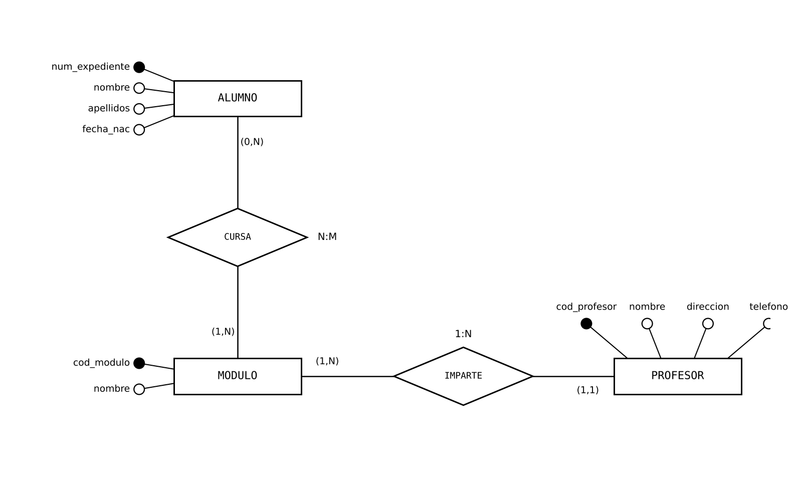
</div>

En los siguientes apartados se explican los elementos que componen un DER. El proceso para construirlo paso a paso se recoge en el **Anexo 1 – Cómo construir un diagrama E/R** de los casos de diseño.

### 2.1. ENTIDAD

Una **entidad** es un objeto, sujeto, lugar, acontecimiento o concepto sobre el que se desea almacenar información.

En el esquema anterior pueden identificarse las siguientes entidades: Alumno, Modulo y Profesor.

Una entidad representa un conjunto de elementos del mismo tipo. Por ejemplo, la entidad Alumno representa al conjunto de alumnos del centro educativo.

Cada entidad se representa mediante un *rectángulo*.

Una **ocurrencia** de una entidad es un elemento concreto perteneciente a ese conjunto. Por ejemplo, Javier Ruiz sería una ocurrencia de la entidad Alumno.

### 2.2. ATRIBUTOS

Un **atributo** es una propiedad o característica de una entidad.

En el ejemplo, la entidad Alumno tiene los siguientes atributos:
- num_expediente;
- nombre;
- apellidos;
- fecha_nac.

> ⚠️ **Importante:** las relaciones también pueden tener atributos.

En la notación utilizada en estos apuntes, los atributos se representan mediante pequeños círculos unidos a la entidad por una línea. Junto a cada círculo se escribe el nombre del atributo.

#### 2.2.1. DOMINIO DE UN ATRIBUTO

El **dominio** de un atributo es el conjunto de valores que puede tomar ese atributo.

Ejemplo de dominios de la entidad Alumno:

| Atributo | Dominio |
|---|---|
| num_expediente | Cadena de caracteres de longitud 9 |
| nombre | Cadena de caracteres de longitud máxima 20 |
| apellidos | Cadena de caracteres de longitud máxima 30 |
| fecha_nac | Fecha válida |

#### 2.2.2. TIPOS DE ATRIBUTOS

##### Atributos simples y compuestos

Un atributo es **simple** cuando no se considera dividido en partes.

Por ejemplo:
- nombre;
- dni;
- salario.

Un atributo es **compuesto** cuando puede dividirse en varios componentes.

Por ejemplo, el atributo direccion podría dividirse en:
- calle;
- numero;
- codigo_postal;
- localidad.

Aunque una fecha puede dividirse conceptualmente en día, mes y año, en una implementación concreta suele almacenarse como un único valor de tipo fecha.

##### Atributos monovaluados y multivaluados

Un atributo es **monovaluado** cuando cada ocurrencia de la entidad puede tener un único valor para ese atributo.

Por ejemplo, cada alumno puede tener un único número de expediente.

Un atributo es **multivaluado** cuando una ocurrencia de la entidad puede tener varios valores para ese atributo.

Por ejemplo, una persona puede tener varios teléfonos:
- teléfono personal;
- teléfono de trabajo;
- teléfono de contacto alternativo.

##### Atributos obligatorios y opcionales

Un atributo es **obligatorio** cuando todas las ocurrencias de una entidad deben tener un valor para ese atributo.

Un atributo es **opcional** cuando algunas ocurrencias pueden no tener ningún valor.

Por ejemplo, fecha_nacimiento podría ser obligatorio en una entidad Persona, mientras que aficiones podría ser opcional.

##### Atributos derivados y no derivados

Un atributo es **derivado** cuando su valor puede obtenerse a partir de otros datos.

Por ejemplo, importe_venta puede calcularse a partir de:
- unidades_vendidas;
- precio_unidad.

Un atributo es **no derivado** cuando su valor se almacena directamente y no se obtiene a partir de otros atributos.

No conviene abusar de los atributos derivados almacenados, porque su valor puede quedar desactualizado si cambian los datos de los que depende.

##### Atributos clave

Una **clave** es un atributo o conjunto de atributos que permite identificar de forma única cada ocurrencia de una entidad.

Una clave debe:
- identificar de forma unívoca cada ocurrencia;
- no admitir valores duplicados;
- no admitir valores nulos;
- ser lo más sencilla y estable posible.

Una clave puede estar formada por un solo atributo o por varios atributos.

Una **clave candidata** es cualquier atributo, o conjunto mínimo de atributos, que cumple las condiciones anteriores. Que sea mínimo significa que, si se quita cualquiera de sus atributos, deja de identificar de forma única. Por ejemplo, en Alumno pueden ser claves candidatas num_expediente y dni.

Entre las claves candidatas se distinguen:
- **Clave primaria:** clave candidata elegida como identificador principal de la entidad.
- **Clave alternativa:** cualquier otra clave candidata que también permite identificar de forma única una ocurrencia.

En el diagrama, la clave primaria se representa con un círculo relleno y la clave alternativa, con un círculo relleno solo hasta la mitad.

<div class="figura">
  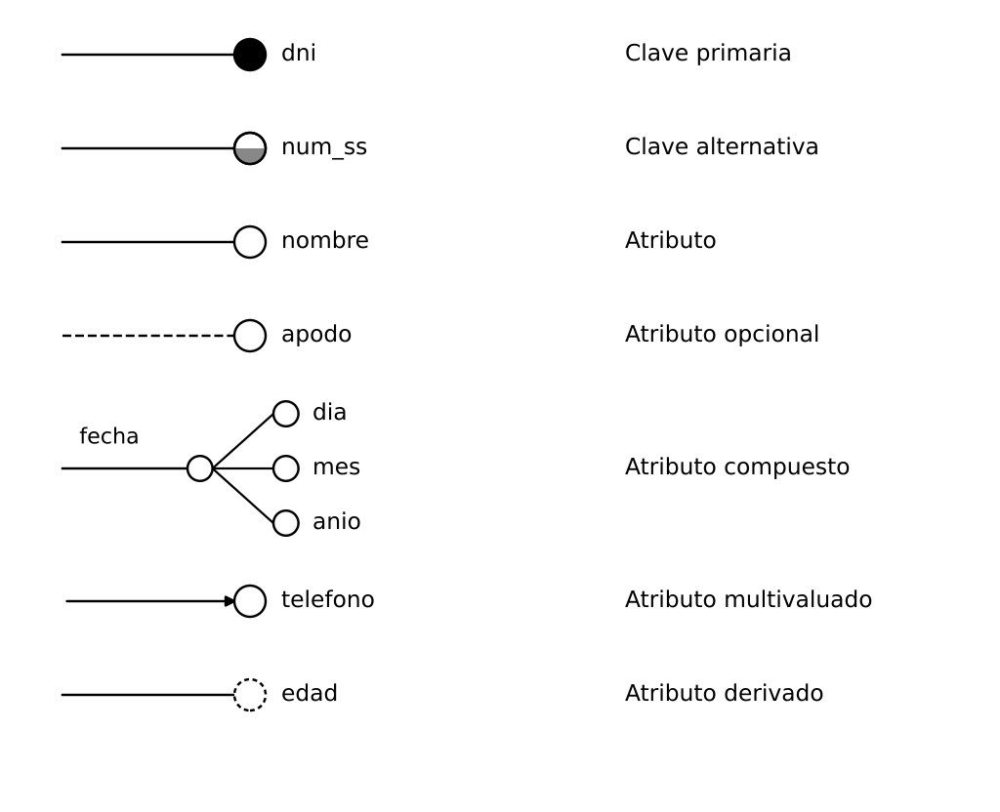
</div>

### 2.3. RELACIONES

Una **relación** es una asociación o correspondencia entre dos o más entidades.

En los enunciados de los ejercicios, las relaciones suelen expresarse mediante verbos o formas verbales.

Por ejemplo:
- un alumno se matricula en un módulo;
- un profesor imparte un módulo;
- un cliente realiza un pedido.

Cada relación se representa mediante un *rombo*, que se une mediante líneas a las entidades participantes.

#### 2.3.1. RELACIÓN BINARIA

Una relación es binaria o de grado 2 cuando participan dos entidades.

<div class="figura">
  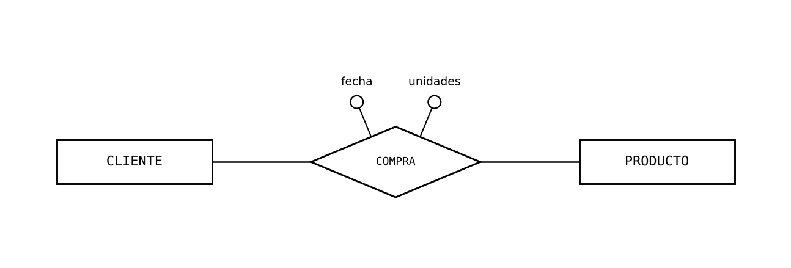
</div>

#### 2.3.2. RELACIÓN UNARIA O REFLEXIVA

Una relación es unaria, reflexiva o de grado 1 cuando relaciona ocurrencias de una misma entidad.

Por ejemplo, un empleado es jefe de otro empleado.

<div class="figura">
  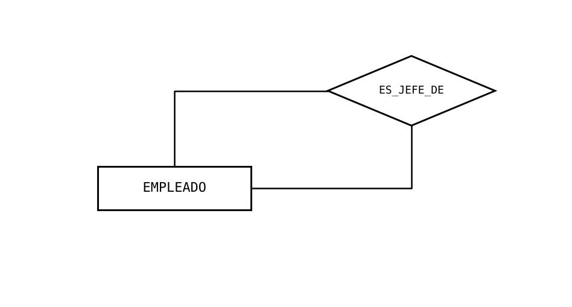
</div>

#### 2.3.3. RELACIÓN TERNARIA

Una relación es ternaria o de grado 3 cuando participan tres entidades.

Por ejemplo, un cliente compra un producto a un vendedor.

Una relación ternaria puede transformarse en varias relaciones binarias en algunos casos, pero no siempre. Una transformación incorrecta puede perder información sobre la asociación simultánea de las tres entidades.

<div class="figura">
  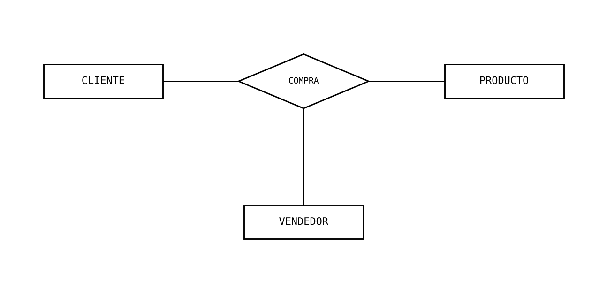
</div>

#### 📝 Problemas
> - Caso de diseño 1 (actividades 1, 2 y 3)

### 2.4. CARDINALIDAD

La **cardinalidad** indica cuántas ocurrencias de una entidad pueden estar relacionadas con una ocurrencia de otra entidad.

Se expresa mediante un valor mínimo y un valor máximo:

- el primer número indica la participación mínima;
- el segundo número indica la participación máxima.

Por ejemplo:

- `(0,1)`: participación opcional y como máximo una ocurrencia;
- `(1,1)`: participación obligatoria y exactamente una ocurrencia;
- `(0,N)`: participación opcional y varias ocurrencias como máximo;
- `(1,N)`: participación obligatoria y varias ocurrencias como máximo.

<div class="figura">
  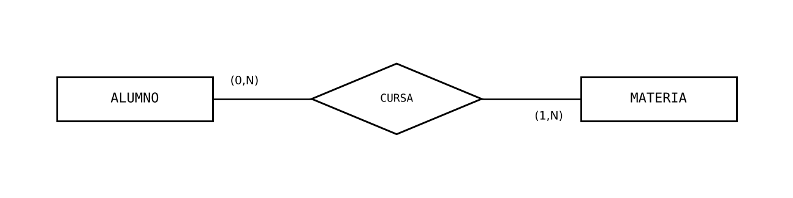
</div>

En estos apuntes, la cardinalidad situada junto a una entidad indica **cuántas ocurrencias de esa entidad** se relacionan con **una** ocurrencia de la otra. En la relación entre ALUMNO y MATERIA:
- la cardinalidad situada junto a MATERIA, `(1,N)`, indica con cuántas materias puede relacionarse un alumno;
- la cardinalidad situada junto a ALUMNO, `(0,N)`, indica con cuántos alumnos puede relacionarse una materia.

> 💡 **Truco:** lee la relación empezando por la entidad del otro extremo: «un alumno cursa `(1,N)` materias», «una materia es cursada por `(0,N)` alumnos».

#### Preguntas para obtener mínimos y máximos


Pensando en la imagen anterior:
- ¿Cada alumno, como mínimo, cuántas materias puede cursar?

  **1**, ya que si no cursa ninguna materia no estaría matriculado.

- ¿Cada alumno, como máximo, cuántas materias puede cursar?

  **N**, ya que puede cursar más de una.

- ¿Cada materia puede ser cursada, como mínimo, por cuántos alumnos?

  **0**, ya que podría existir una materia sin alumnos matriculados.

- ¿Cada materia puede ser cursada, como máximo, por cuántos alumnos?

  **N**, ya que puede haber varios alumnos matriculados.

#### Cardinalidad en relaciones ternarias

En una relación ternaria, la cardinalidad situada junto a una entidad indica cuántas ocurrencias de esa entidad se relacionan con **cada pareja** de ocurrencias de las otras dos.

Para obtenerla, se fija una ocurrencia de cada una de las otras dos entidades y se pregunta por la tercera. Por ejemplo, si un profesor imparte una asignatura a un grupo:

- Para una asignatura y un grupo concretos, ¿cuántos profesores la imparten? **Uno**, así que junto a PROFESOR va `(1,1)`.
- Para un profesor y un grupo concretos, ¿cuántas asignaturas imparte? **Una o varias**, así que junto a ASIGNATURA va `(1,N)`.
- Para un profesor y una asignatura concretos, ¿a cuántos grupos la imparte? **A uno o a varios**, así que junto a GRUPO va `(1,N)`.

<div class="figura">
  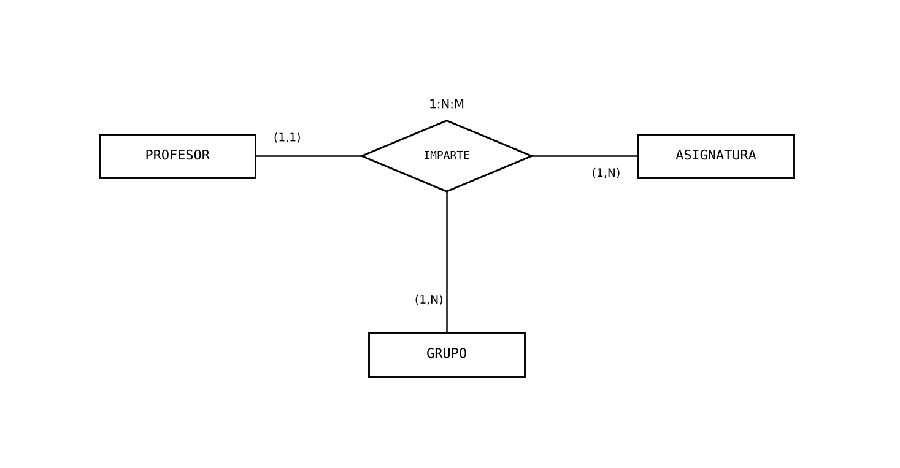
</div>

El tipo de correspondencia se forma con los tres máximos; en este caso, `1:N:M`.

### 2.5. TIPO DE CORRESPONDENCIA

El **tipo de correspondencia** resume el **número máximo de ocurrencias** que pueden relacionarse entre dos entidades. Se obtiene a partir de los máximos de las dos cardinalidades: por ejemplo, `(1,N)` y `(0,N)` dan una correspondencia `N:M`, y `(1,1)` y `(1,N)` dan `1:N`.

#### Relación uno a uno `1:1`

Cada ocurrencia de una entidad se relaciona como máximo con una ocurrencia de la otra entidad, y viceversa.

Ejemplo:
- un centro educativo tiene un único director;
- un director dirige un único centro educativo.

#### Relación uno a muchos `1:N`

Una ocurrencia de la primera entidad puede relacionarse con muchas ocurrencias de la segunda entidad, mientras que cada ocurrencia de la segunda se relaciona como máximo con una de la primera.

Ejemplo:
- un municipio pertenece a una provincia;
- una provincia puede tener muchos municipios.

#### Relación muchos a muchos `N:M`

Una ocurrencia de cada entidad puede relacionarse con muchas ocurrencias de la otra entidad.

Ejemplo:
- un cliente puede comprar varios productos;
- un producto puede ser comprado por varios clientes.

#### 📝 Problemas
> - Caso de diseño 1 (actividades 4 y 5)

### 2.6. ENTIDAD DÉBIL Y FUERTE

Una **entidad débil** es una entidad cuya **existencia o identificación** depende de otra entidad, denominada **entidad fuerte**.

Las entidades débiles se representan mediante un *rectángulo doble*.

#### Tipos de dependencia

##### Dependencia en existencia

Existe dependencia en existencia cuando las ocurrencias de una entidad débil no tienen sentido sin una ocurrencia de la entidad fuerte.

Por ejemplo, una línea de pedido no puede existir si no existe el pedido al que pertenece.

##### Dependencia en identificación

Existe dependencia en identificación cuando, **además de depender de la entidad fuerte para existir**, la entidad débil necesita la clave de la entidad fuerte para poder identificarse.

Por ejemplo, una línea de pedido puede identificarse mediante la combinación del identificador del pedido y el número de la propia línea.

En el diagrama, el tipo de dependencia se indica en el rombo de la relación: **E** para la dependencia en existencia e **I** para la dependencia en identificación.

<div class="figura">
  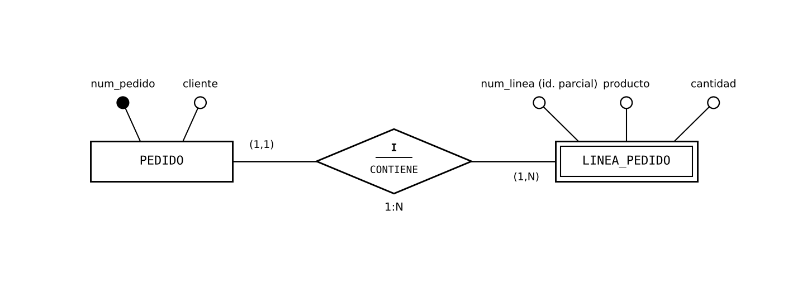
</div>

#### 📝 Problemas
> - Caso de diseño 2
> - Caso de diseño 3


[↑ Volver al índice](#indice)

## 3. MODELO E/R AMPLIADO

El **modelo E/R ampliado** recoge los conceptos y especificaciones del modelo E/R y añade otros que permiten representar con mayor precisión determinadas situaciones del mundo real, mejorando el diseño de las bases de datos.

Dentro de este modelo se definen los siguientes conceptos:

### 3.1. SUPERCLASE

Una **superclase** es una entidad genérica que agrupa las características comunes de un conjunto de entidades.

Sus atributos son compartidos por las entidades que pertenecen a las subclases asociadas a ella.

Por ejemplo, la entidad Empleado puede ser una superclase que contenga atributos comunes como dni, nombre, apellidos y fecha_alta.

### 3.2. SUBCLASE

Una **subclase** es una entidad que forma parte de una superclase y que añade atributos o relaciones específicas.

Cada ocurrencia de una subclase es también una ocurrencia de su superclase. Por ello, hereda los atributos de esta, además de poder tener atributos propios.

Por ejemplo, Operario y Encargado pueden ser subclases de Empleado:

- Operario además puede tener el atributo especialidad.
- Encargado además puede tener el atributo num_equipos_a_su_cargo.

Otro ejemplo, en un centro de estudios, Persona podría ser una superclase, mientras que Alumno y Profesor serían subclases.

### 3.3. GENERALIZACIÓN

La **generalización** es el proceso de definir una superclase a partir de las características comunes de varias subclases.

Por ejemplo, si Alumno y Profesor comparten dni, nombre y apellidos, se puede crear la superclase Persona con esos atributos comunes.

Una generalización se representa mediante un *triángulo invertido* que une la superclase con sus subclases.

### 3.4. ESPECIALIZACIÓN

La **especialización** es el proceso inverso a la generalización. Consiste en identificar subclases dentro de una superclase, atendiendo a atributos, relaciones o restricciones específicas.

Por ejemplo, a partir de la superclase Empleado, se pueden especializar las subclases Operario y Encargado según las características propias de cada tipo de empleado.

---

Conforme a las restricciones de existencia de las ocurrencias de las entidades, una **especialización** —o, vista en sentido inverso, una **generalización**— puede ser:

- **Exclusiva**, si una ocurrencia de la superclase solo puede pertenecer a una subclase.
- **Solapada**, si una ocurrencia de la superclase puede pertenecer a varias subclases.
- **Total**, si todas las ocurrencias de la superclase deben pertenecer a alguna subclase.
- **Parcial**, si no todas las ocurrencias de la superclase tienen por qué pertenecer a alguna subclase.

En el diagrama, la especialización **total** se indica con un círculo sobre el triángulo, y la **exclusiva**, con un arco que corta las líneas de las subclases. Si no hay círculo, es parcial; si no hay arco, es solapada.

Estas restricciones pueden combinarse, dando lugar a los siguientes tipos:

#### a) Exclusiva total

<div class="figura">
  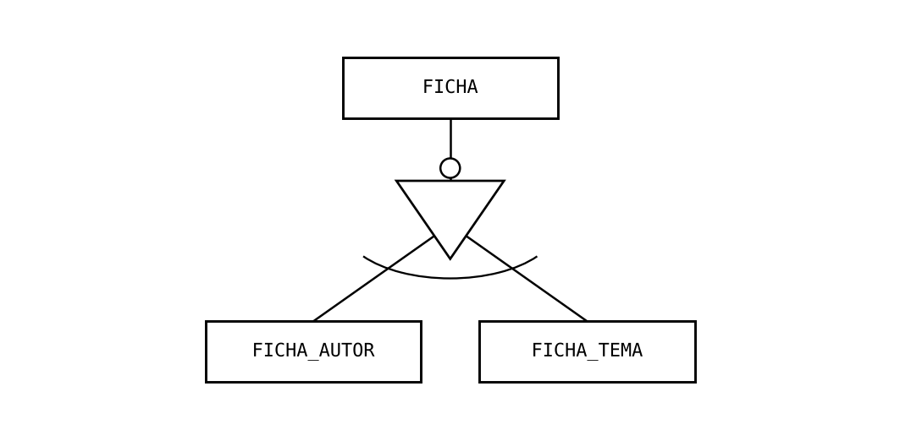
</div>

Todas las fichas son de autor o de tema, y ninguna puede ser de los dos tipos a la vez.


#### b) Exclusiva parcial

<div class="figura">
  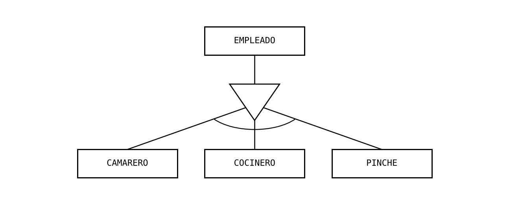
</div>

Un empleado del restaurante puede ser camarero, cocinero o pinche, pero solo una de esas cosas. También puede tener otro puesto que no se recoge como subclase.


#### c) Solapada total

<div class="figura">
  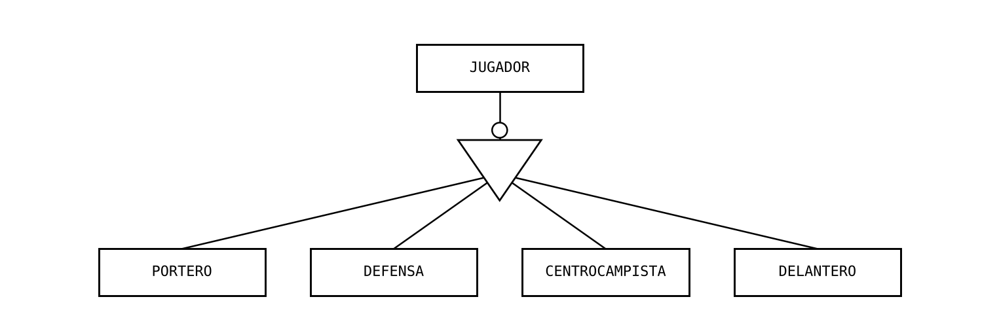
</div>

Todo jugador juega al menos en una posición, y puede jugar en varias: un defensa puede jugar también como centrocampista.


#### d) Solapada parcial

<div class="figura">
  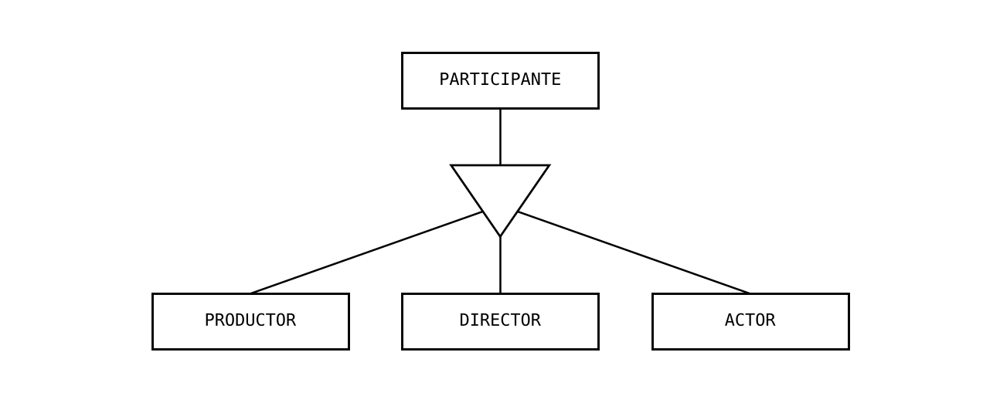
</div>

Un participante en una película puede ser productor, director o actor, varias de esas cosas a la vez, o tener otro papel distinto.
  

### 3.5. JERARQUÍAS CON VARIOS NIVELES

A veces una sola especialización no basta para recoger todas las reglas del enunciado. Ocurre, por ejemplo, cuando algunas subclases pueden solaparse entre sí y otras no.

En ese caso se agrupan las subclases que son excluyentes bajo una **entidad intermedia**, que es a la vez subclase de la superclase original y superclase de esas subclases. Así se forma una jerarquía de varios niveles, y cada nivel tiene su propio tipo de especialización.

**Ejemplo.** En una universidad hay alumnos y personal, y una misma persona puede ser las dos cosas: un doctorando, por ejemplo, estudia y también da clase. Todo el personal es docente (PDI) o de administración y servicios (PAS), nunca ambas cosas.

- **Nivel 1:** PERSONA se especializa en ALUMNO y PERSONAL. Es **total y solapada**: toda persona es alumno, personal o ambas cosas.
- **Nivel 2:** PERSONAL se especializa en PDI y PAS. Es **total y exclusiva**: todo el personal es PDI o PAS, pero nunca las dos cosas.

<div class="figura">
  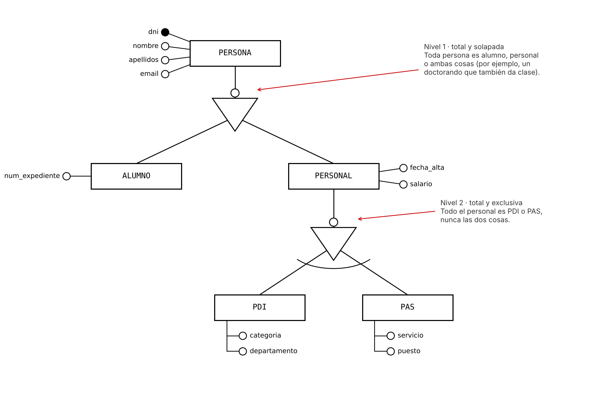
</div>

PERSONAL hereda los atributos de PERSONA (dni, nombre…) y añade los suyos (fecha_alta, salario), que heredan a su vez PDI y PAS.

> 💡 **Nota:** si la entidad intermedia no tiene atributos propios, sigue siendo útil: permite expresar en el diagrama una regla que, con una sola especialización, habría que anotar aparte como restricción.

#### 📝 Problemas

> - Caso de diseño 4
> - Caso de diseño 5
> - Caso de diseño 6


[↑ Volver al índice](#indice)

## 4. MODELO RELACIONAL

El **modelo relacional** organiza la información en tablas formadas por filas y columnas, lo que facilita su comprensión y manejo.

Permite relacionar datos de diferentes tablas mediante claves y reducir la redundancia mediante un diseño adecuado. Además, incorpora restricciones que ayudan a mantener la integridad y la consistencia de la información.

### 4.1. ELEMENTOS DE UNA RELACIÓN

El elemento principal del modelo relacional es la **relación**.

Una relación es una tabla. Cada ocurrencia de la relación es una fila, denominada **tupla** o **registro**. Cada propiedad o característica de las ocurrencias es una **columna**, denominada **atributo**.

> ⚠️ **Importante:** no debes confundir el concepto de relación en el modelo relacional con el concepto de relación en el modelo E/R.

#### Relación en el modelo E/R

Es un concepto lógico que representa una asociación entre entidades.

**Ejemplo:** “Un cliente realiza un pedido” representa una relación entre las entidades Cliente y Pedido.

#### Relación en el modelo relacional

Es una estructura lógica representada mediante una tabla.

Contiene tuplas o filas y atributos o columnas, que almacenan los datos de las entidades o de las asociaciones entre ellas.

Por ejemplo, la relación Pedido puede contener una fila por cada pedido realizado.

#### Dominio

El **dominio** de un atributo es el conjunto de valores válidos que puede tomar dicho atributo.

Los dominios pueden clasificarse en:

- **General:** cuando los valores pueden ser todos los posibles dentro del tipo de dato asociado a la columna.
- **Restringido:** cuando solo se admiten los valores comprendidos dentro de un subconjunto del dominio general.

Por ejemplo, una columna 'nota' de tipo numérico podría tener como dominio restringido los valores comprendidos entre 0 y 10.

#### Claves

Las claves del modelo E/R pasan al modelo relacional con el mismo significado:

- **Clave candidata:** atributo o conjunto mínimo de atributos que identifica de forma única cada fila de una tabla.
- **Clave primaria:** clave candidata elegida para identificar las filas de la tabla. No admite valores nulos ni repetidos.
- **Clave alternativa:** cualquier otra clave candidata. No admite valores repetidos.
- **Clave ajena:** atributo o conjunto de atributos de una tabla cuyos valores deben coincidir con los de la clave primaria, o de una clave alternativa, de otra tabla, o de la misma. Es lo que permite relacionar las tablas entre sí.

Por ejemplo, en una tabla CIUDAD, la columna id_pais es una clave ajena que hace referencia a la clave primaria de la tabla PAIS. El apartado 4.3 explica cómo controla el SGBD esta referencia.


### 4.2. RESTRICCIONES DEL MODELO RELACIONAL

Los datos almacenados en una base de datos tienen como objetivo representar situaciones del mundo real de forma coherente.

Existen dos tipos de restricciones:

#### Restricciones propias o inherentes al modelo relacional

Son condiciones generales que deben cumplirse en toda base de datos que siga el modelo relacional.

- No pueden existir dos tuplas o filas con exactamente el mismo contenido en todas sus columnas.
- La clave primaria no puede contener valores nulos.
- La clave primaria no puede contener valores repetidos.
- Una clave alternativa no puede contener valores repetidos.
- Cada celda contiene un único valor (atómico): no puede haber listas de valores en una misma columna de una fila.
- El orden de las filas y el de las columnas no es significativo: la información es la misma aunque se ordenen de otra forma.

El usuario decide qué atributo o conjunto de atributos actúa como clave primaria, pero, una vez definida, el modelo relacional exige que cumpla las restricciones anteriores.

#### Restricciones propias del usuario

Son condiciones específicas de una base de datos concreta. Dependen de las necesidades de los usuarios y de las reglas del sistema de información que se quiere representar.

Por ejemplo, en una empresa puede establecerse que el sueldo de un empleado deba ser positivo.

El usuario puede definir, entre otras, las siguientes restricciones:

- Clave primaria (`PRIMARY KEY`).
- Unicidad o clave alternativa (`UNIQUE`).
- Obligatoriedad (`NOT NULL`).
- Clave ajena (`FOREIGN KEY`).
- Verificación o comprobación (`CHECK`).
- Aserciones o asertos (`ASSERTION`).
- Disparadores (`TRIGGER`).

> 💡 **Nota:** entre paréntesis se indican las palabras clave de SQL con las que estas restricciones se implementan en el modelo físico de la base de datos. Se estudiarán con detalle en temas posteriores.


### 4.3. INTEGRIDAD REFERENCIAL

Las restricciones de **integridad referencial** permiten que el SGBD controle la coherencia entre los valores almacenados en una clave ajena y los valores existentes en la clave primaria —o en una clave alternativa— de la tabla referenciada.

#### Ejemplo

Cada ciudad pertenece a un único país, mientras que un país puede tener varias ciudades.

Tabla PAIS:

| id_pais | nombre | continente |
|---:|---|---|
| 1 | España | Europa |
| 2 | Francia | Europa |
| 3 | Japón | Asia |

Tabla CIUDAD:

| id_ciudad | nombre | poblacion | id_pais |
|---:|---|---:|---:|
| 1 | Santander | 172000 | 1 |
| 2 | Madrid | 3300000 | 1 |
| 3 | París | 2100000 | 2 |
| 4 | Lyon | 520000 | 2 |
| 5 | Tokio | 14000000 | 3 |

Los valores almacenados en CIUDAD.id_pais deben existir previamente en PAIS.id_pais.

#### Inserción en la tabla referenciante

Al insertar una nueva fila en CIUDAD, el SGBD comprueba que el valor de id_pais exista en la columna id_pais de alguna fila de PAIS.

Por tanto, la siguiente inserción sería válida:

| id_ciudad | nombre | poblacion | id_pais |
|---:|---|---:|---:|
| 6 | Bilbao | 345000 | 1 |

Sin embargo, la siguiente inserción sería rechazada:

| id_ciudad | nombre | poblacion | id_pais |
|---:|---|---:|---:|
| 7 | Lisboa | 550000 | 4 |

#### Modificación de la clave ajena

Al modificar el valor de id_pais en una fila de CIUDAD, el SGBD comprueba que el nuevo valor exista en la tabla PAIS.

Por ejemplo, sería válido cambiar el país de Bilbao de 1 a 2:

| id_ciudad | nombre | poblacion | id_pais |
|---:|---|---:|---:|
| 6 | Bilbao | 345000 | 2 |

Sin embargo, no sería válido modificar su id_pais por el valor 4, ya que no existe ningún país con ese identificador. En ese caso, el SGBD rechazaría la modificación y la fila conservaría su valor anterior.

#### Borrado en la tabla referenciada

Al intentar eliminar una fila de la tabla PAIS, pueden definirse diferentes comportamientos.

Supongamos que se desea eliminar el país con id_pais = 2, es decir, Francia. Las ciudades París y Lyon tienen ese valor en su clave ajena.

- **Borrado en cascada (`ON DELETE CASCADE`):** se elimina el país Francia y se eliminan también las ciudades París y Lyon.

- **Borrado restringido (`ON DELETE RESTRICT`):** no se permite eliminar Francia mientras existan ciudades que tengan id_pais = 2.

- **Borrado con puesta a nulos (`ON DELETE SET NULL`):** se elimina Francia y el valor de id_pais de París y Lyon pasa a ser `NULL`.

  Esta opción solo puede utilizarse si la columna CIUDAD.id_pais admite valores nulos.

- **Borrado con valor por defecto (`ON DELETE SET DEFAULT`):** se elimina Francia y el valor de id_pais de sus ciudades se sustituye por un valor por defecto.

  El valor por defecto debe existir previamente en la tabla PAIS. Por ejemplo, podría utilizarse un país especial denominado 'Sin asignar'.

#### Modificación de la clave primaria

Al intentar modificar el valor de id_pais en una fila de PAIS, también pueden definirse diferentes comportamientos.

Supongamos que se desea cambiar el identificador de España de 1 a 10. Las ciudades Santander y Madrid tienen inicialmente id_pais = 1.

- **Modificación en cascada (`ON UPDATE CASCADE`):** se modifica el identificador de España de 1 a 10 y se actualiza automáticamente el valor de id_pais de Santander y Madrid a 10.

- **Modificación restringida (`ON UPDATE RESTRICT`):** no se permite modificar el identificador de España mientras existan ciudades que tengan id_pais = 1.

- **Modificación con puesta a nulos (`ON UPDATE SET NULL`):** se modifica el identificador de España y el valor de id_pais de sus ciudades pasa a ser `NULL`.

  Esta opción solo puede utilizarse si la columna CIUDAD.id_pais admite valores nulos.

- **Modificación con valor por defecto (`ON UPDATE SET DEFAULT`):** se modifica el identificador de España y el valor de id_pais de sus ciudades se sustituye por un valor por defecto.

  El valor por defecto debe existir previamente en la tabla PAIS.
 

### 4.4. REPRESENTACIÓN DEL MODELO RELACIONAL

Un **esquema relacional** representa la estructura lógica de una base de datos relacional. Muestra las relaciones o tablas que la componen, sus atributos, sus claves y las relaciones existentes entre ellas.

Existen distintas formas de representar un esquema relacional:

#### Esquema relacional conectado a columnas

En esta notación, cada tabla muestra sus atributos o columnas. Las líneas unen las tablas relacionadas mediante claves ajenas y pueden incluir la cardinalidad de la relación.

<div class="figura">
  
</div>

#### Esquema relacional con notación *crow's foot* o pata de cuervo

Esta notación representa las relaciones entre tablas mediante símbolos situados en los extremos de las líneas.

La pata de cuervo indica la parte “muchos” de una relación. En relaciones de tipo uno a muchos, suele situarse junto a la tabla que contiene la clave ajena.

<div class="figura">
  
</div>

#### Esquema relacional textual

En esta notación, cada relación se expresa mediante su nombre seguido de una lista de atributos entre paréntesis.

Los atributos subrayados forman la clave primaria. La flecha `→` indica que un atributo, o un conjunto de atributos, es una clave ajena, y a continuación se escribe la relación a la que referencia.

<div class="figura">
  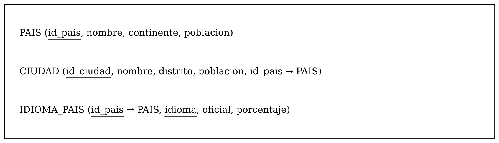
</div>

### 4.5. PASO DEL MODELO E/R AL MODELO RELACIONAL

Para transformar un diagrama E/R en un esquema relacional se aplican unas reglas para cada elemento del diagrama: entidades, relaciones 1:1, 1:N y N:M, atributos multivaluados, entidades débiles, especializaciones, relaciones reflexivas y ternarias, entre otros.

Estas reglas, con ejemplos de cada caso, se recogen en el **Anexo 2 – Del modelo E/R al relacional** de los casos de diseño.

#### 📝 Problemas

> - Caso de diseño 7
> - Caso de diseño 8
> - Caso de diseño 9
> - Caso de diseño 10


[↑ Volver al índice](#indice)

## 5. NORMALIZACIÓN

Al diseñar una base de datos relacional es necesario evaluar la calidad del diseño. Uno de los criterios utilizados son las **formas normales**.

La **normalización** es el proceso de organizar y, cuando sea necesario, dividir las relaciones de una base de datos para que cada dato se guarde una sola vez.

Un diseño normalizado busca:

- Reducir la duplicación innecesaria de información.
- Evitar anomalías de inserción, modificación y borrado.
- Mantener la coherencia e integridad de los datos.
- Realizar descomposiciones sin pérdida de información.

Las formas normales son **acumulativas**: para que una tabla esté en una forma normal determinada, debe cumplir también las anteriores (1FN → 2FN → 3FN).

> 💡 **Nota:** un diseño conceptual adecuado mediante el modelo Entidad-Relación facilita la normalización, pero no evita la necesidad de comprobar las relaciones obtenidas al transformarlo al modelo relacional.

### 5.1. UNA TABLA CON PROBLEMAS

Relación SUMINISTROS:

> Clave primaria (cod_prov, cod_articulo)

| cod_prov | cod_articulo | cantidad | ciudad |
|---|---|---:|---|
| P1 | A1 | 300 | Santander |
| P1 | A2 | 200 | Santander |
| P1 | A3 | 400 | Santander |
| P2 | A1 | 300 | Bilbao |
| P2 | A2 | 400 | Bilbao |
| P3 | A2 | 200 | Oviedo |

La clave primaria indica qué artículo suministra cada proveedor. Sin embargo, la ciudad depende únicamente del proveedor: **un proveedor está en una única ciudad**. Por eso la ciudad de P1 está guardada tres veces.

Esta redundancia provoca tres **anomalías**:

- **Anomalía de modificación:** si P1 se traslada a Torrelavega, hay que cambiar tres filas. Si se olvida alguna, la tabla se contradice.
- **Anomalía de borrado:** si se borra el único suministro de P3, se pierde también que P3 está en Oviedo.
- **Anomalía de inserción:** no se puede dar de alta a un proveedor P4 de León hasta que suministre algún artículo, porque cod_articulo forma parte de la clave primaria y no puede quedar vacío.

El origen del problema es que la relación SUMINISTROS mezcla dos hechos diferentes, que deben almacenarse en relaciones distintas:

- Qué artículos suministra cada proveedor y en qué cantidad.
- En qué ciudad se encuentra cada proveedor.

### 5.2. DEPENDENCIAS FUNCIONALES

#### Dependencia funcional

Existe una dependencia funcional entre dos conjuntos de atributos cuando cada valor de un atributo, o conjunto de atributos, determina un único valor de otro.

Se representa mediante una flecha:

```text
A → B
```

Se lee: «A determina funcionalmente a B». El atributo o conjunto de atributos situado a la izquierda de la flecha se denomina **determinante**.

Por ejemplo:

```text
cod_prov → ciudad
```

Conocido el proveedor, se conoce su ciudad.

> ⚠️ **Importante:** las dependencias salen de las reglas del negocio, no de los datos que haya en la tabla en un momento dado.

#### Dependencia funcional completa

Una dependencia funcional es completa cuando un atributo depende de toda una clave compuesta y no solo de una parte de ella.

```text
(cod_prov, cod_articulo) → cantidad
```

Para saber la cantidad suministrada hacen falta el proveedor y el artículo: conocer solo uno de los dos no basta.

#### Dependencia funcional parcial

Existe una dependencia funcional parcial cuando un atributo no clave depende únicamente de una parte de una clave primaria compuesta.

```text
cod_prov → ciudad
```

La ciudad depende solo de cod_prov, no de la clave completa. Esta situación incumple la segunda forma normal.

#### Dependencia funcional transitiva

Existe una dependencia funcional transitiva cuando un atributo no clave depende de otro atributo no clave, que a su vez depende de la clave primaria.

```text
A → B → C
```

Por ejemplo, en una tabla de pedidos, `id_orden → id_cliente → nom_cliente`. Esta situación incumple la tercera forma normal.

### 5.3. PRIMERA FORMA NORMAL (1FN)

Una relación está en 1FN cuando cada celda contiene un único valor (atómico) y no existen grupos de columnas que se repiten.

Una tabla puede incumplir la 1FN de dos formas, que en el fondo son el mismo problema:

- **Celdas multivaluadas:** por ejemplo, un pedido con `num_art = 3786 / 4011 / 9132`.
- **Grupos repetitivos:** columnas como `num_art_1`, `nom_art_1`, `num_art_2`, `nom_art_2`…

En los dos casos, un pedido tiene varios artículos y la tabla no tiene sitio para ellos.

**Solución:** se lleva el grupo que se repite a otra tabla, junto con la clave de la tabla original.

Por ejemplo, la tabla de pedidos

<p>ORDENES (<u>id_orden</u>, fecha, id_cliente, nom_cliente, ciudad, num_art, nom_art, cant, precio)</p>

con varios artículos en cada fila, se divide en:

<p>ORDENES (<u>id_orden</u>, fecha, id_cliente, nom_cliente, ciudad)<br>
ARTICULOS_ORDENES (<u>id_orden</u> → ORDENES, <u>num_art</u>, nom_art, cant, precio)</p>

### 5.4. SEGUNDA FORMA NORMAL (2FN)

Una relación está en 2FN si cumple las dos condiciones siguientes:

1. Está en 1FN.
2. Todos los atributos no clave dependen funcionalmente de la clave primaria completa.

> ⚠️ **Importante:** la 2FN solo puede incumplirse cuando la clave primaria es compuesta. Si una relación está en 1FN y su clave primaria está formada por un único atributo, cumple automáticamente la 2FN.

En el ejemplo, ORDENES ya está en 2FN porque su clave es simple. En cambio, en ARTICULOS_ORDENES el nombre y el precio dependen solo de una parte de la clave:

```text
num_art → nom_art, precio
```

Los datos del artículo pasan a su propia tabla:

<p>ARTICULOS_ORDENES (<u>id_orden</u> → ORDENES, <u>num_art</u> → ARTICULOS, cant)<br>
ARTICULOS (<u>num_art</u>, nom_art, precio)</p>

### 5.5. TERCERA FORMA NORMAL (3FN)

Una relación está en 3FN si cumple las dos condiciones siguientes:

1. Está en 2FN.
2. Ningún atributo no clave depende de otro atributo no clave.

Dicho de otro modo, los atributos no clave deben depender directamente de la clave primaria.

En el ejemplo, en ORDENES el nombre y la ciudad dependen del cliente, no del pedido:

```text
id_orden → id_cliente → nom_cliente, ciudad
```

Los datos del cliente pasan a su propia tabla, e id_cliente se queda en ORDENES como clave ajena. El esquema final en 3FN es:

<p>ORDENES (<u>id_orden</u>, fecha, id_cliente → CLIENTES)<br>
CLIENTES (<u>id_cliente</u>, nom_cliente, ciudad)<br>
ARTICULOS (<u>num_art</u>, nom_art, precio)<br>
ARTICULOS_ORDENES (<u>id_orden</u> → ORDENES, <u>num_art</u> → ARTICULOS, cant)</p>

De una tabla se ha pasado a cuatro, y cada una guarda un único hecho: los pedidos, los clientes, los artículos y qué artículos lleva cada pedido.

> 💡 **Nota:** el ejemplo completo, con los datos de cada tabla en cada paso, está en la presentación **Normalización** (Classroom).

> 💡 **Para pensar:** con este diseño, si la raqueta pasa a costar 70 €, los pedidos antiguos parecerán más caros de lo que se cobró. El precio actual de un artículo y el precio al que se vendió en un pedido concreto son datos distintos. La solución habitual es guardar también precio_venta en ARTICULOS_ORDENES: no es redundancia, porque depende del pedido y del artículo a la vez.

### 5.6. RESUMEN: TRES PREGUNTAS

| Forma | Pregunta | Si la respuesta es sí… |
|---|---|---|
| 1FN | ¿Hay celdas con varios valores o columnas que se repiten? | Lleva el grupo a otra tabla junto con la clave original. |
| 2FN | ¿Algún atributo depende solo de una parte de una clave compuesta? | Llévalo a una tabla cuya clave sea esa parte. |
| 3FN | ¿Algún atributo depende de otro que no es clave? | Llévalo a una tabla cuya clave sea ese atributo, que se queda como clave ajena. |

> 💡 **Nota:** existen formas normales superiores (FNBC, 4FN, 5FN), que no se estudian en este curso. En la práctica, la mayoría de los diseños se dan por buenos cuando están en 3FN.

#### 📝 Problemas

> - Presentaciones de clase «Normalización» y «Ejemplos de normalización» (en Classroom)
> - Unidad 2 · Hoja de ejercicios 2 (Normalización): actividades 1 a 5

[↑ Volver al índice](#indice)
